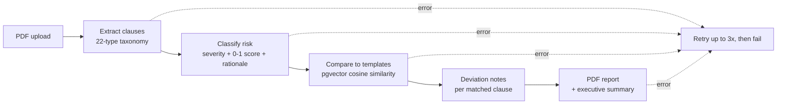
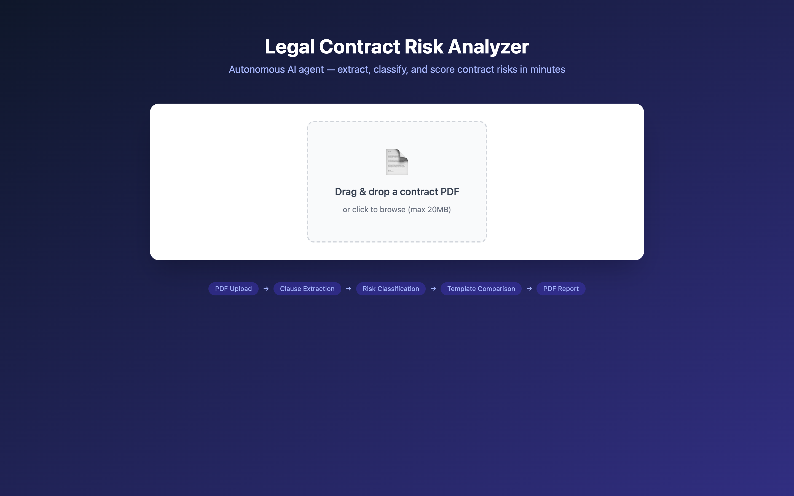
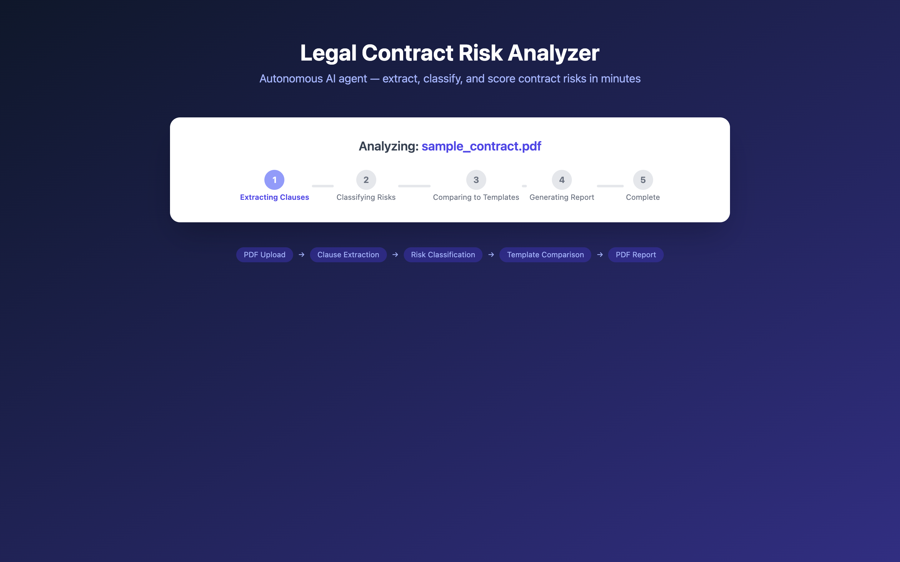
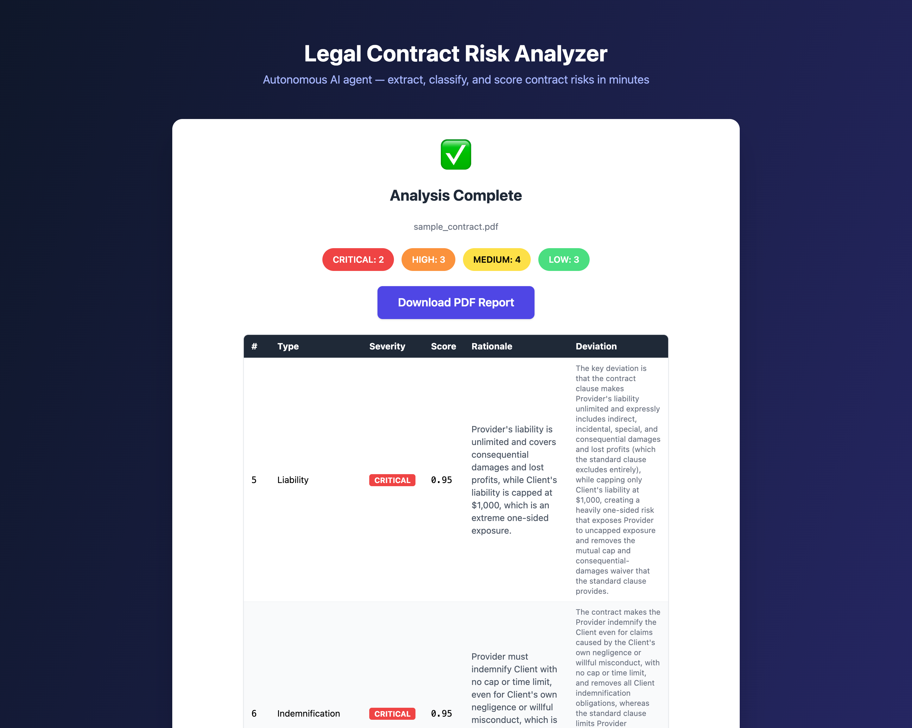
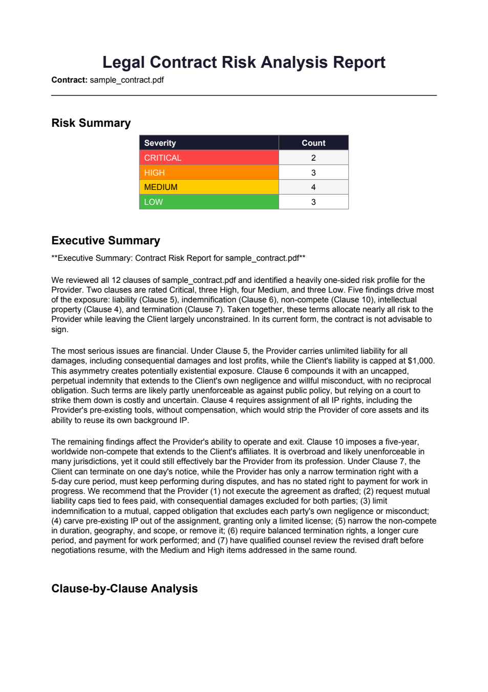
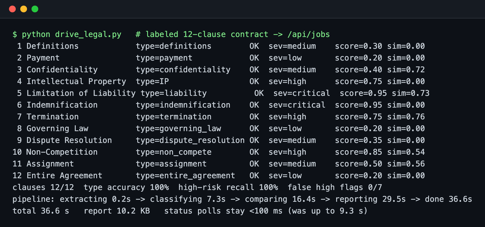

# Legal Contract Risk Analyzer

**Agentic LLM workflow** that reads a contract PDF, extracts and classifies every clause, scores legal risk, benchmarks each clause against standard templates using **vector similarity search**, and generates a PDF risk report with an executive summary.

> **Keywords:** agentic AI · LangGraph · LLM tool use / structured outputs · retrieval · embeddings · pgvector · semantic similarity search · risk scoring · contract analysis / legal tech · multi-model routing · retry & error handling · FastAPI · async · PostgreSQL · React · TypeScript · Docker

## Highlights

- **100% recall on high-risk clauses with zero false alarms:** on a labeled 12-clause test contract, all 5 dangerous clauses (uncapped liability, one-sided indemnity, 5-year worldwide non-compete, IP assignment, one-day termination) were flagged high/critical and none of the 7 benign clauses were; clause extraction and 22-way clause-type classification were 12/12.
- **~37 seconds from upload to finished PDF report**, with a non-blocking async backend (status polling stays under 100 ms during analysis, down from up to 9.3 s before the async fix).

> Measured on a labeled *synthetic* contract — see [Methodology](#methodology--honest-caveats).

## Tech stack

| Layer | Technologies |
|---|---|
| Orchestration | **LangGraph** state machine (5 nodes, conditional edges, 3 retries per node, dedicated error node) |
| LLMs | **Anthropic Claude** with forced tool use and JSON-schema outputs; larger model for extraction, classification and summary, **Haiku** for per-clause deviation notes (multi-model routing) |
| Embeddings / search | OpenAI `text-embedding-3-small` (1536-d), **PostgreSQL + pgvector**, IVFFlat cosine index |
| Backend | Python 3.12, **FastAPI**, `asyncpg`, Pydantic v2, `pdfplumber`, `reportlab` |
| Frontend | **React**, TypeScript, Vite, Tailwind CSS, drag-and-drop upload with live progress tracker |
| Infra | **Docker Compose**, Nginx |

## How it works



1. **Extract** – the model returns clauses through a forced `submit_clauses` tool call (typed enum of 22 clause types).
2. **Classify** – each clause gets a severity (`critical/high/medium/low`), a 0–1 risk score and a one-sentence rationale.
3. **Compare** – each clause is embedded and matched against standard NDA / MSA / SLA template clauses by cosine similarity; matches above 0.5 get a one-sentence deviation note.
4. **Report** – an executive summary plus a clause-by-clause table is rendered to PDF.

## Screenshots

*Synthetic sample contract.*











## Quick start

Requires Docker, an Anthropic API key and an OpenAI API key (embeddings).

```bash
cp .env.example .env     # put your real keys in .env (git-ignored)
docker compose up --build
```

- Frontend: http://localhost:3000
- API docs: http://localhost:8000/docs

| Variable | Notes |
|---|---|
| `ANTHROPIC_API_KEY` | Required |
| `OPENAI_API_KEY` | Required (embeddings) |
| `POSTGRES_PASSWORD` | Optional override; set a strong value beyond local use |
| `DATABASE_URL`, `REPORTS_DIR` | Set by Docker Compose |

## API

| Method | Path | Purpose |
|---|---|---|
| POST | `/api/jobs` | Upload a PDF (max 20 MB), returns `job_id` and starts the agent |
| GET | `/api/jobs/{id}` | Status (`extracting → classifying → comparing → reporting → done`) and clause results |
| GET | `/api/jobs/{id}/report` | Download the generated PDF report |

## Methodology & honest caveats

- [`benchmarks/run_benchmark.py`](benchmarks/run_benchmark.py) builds a 12-clause synthetic contract (5 deliberately risky clauses, 7 benign), runs it through the API and scores clause count, clause type, and high/critical flagging. [`benchmarks/probe_responsiveness.py`](benchmarks/probe_responsiveness.py) measures status-poll latency during a running job.
- Test data is synthetic and the labels were written by the author; real contracts are longer and messier. The template library is small (15 clauses across 3 templates), so similarity matching is a demo, not a production clause bank.
- The recorded run used a local Claude-CLI-backed stand-in for the Anthropic API and local `all-MiniLM-L6-v2` embeddings (zero-padded to 1536-d), so latency and similarity scores are illustrative.
- Output is decision support, **not legal advice**.

## Security notes

Secrets are read from the environment only; `.env` is git-ignored and excluded from Docker images. Published ports bind to `127.0.0.1`. CORS is permissive and there is no authentication — add both before exposing the service.
